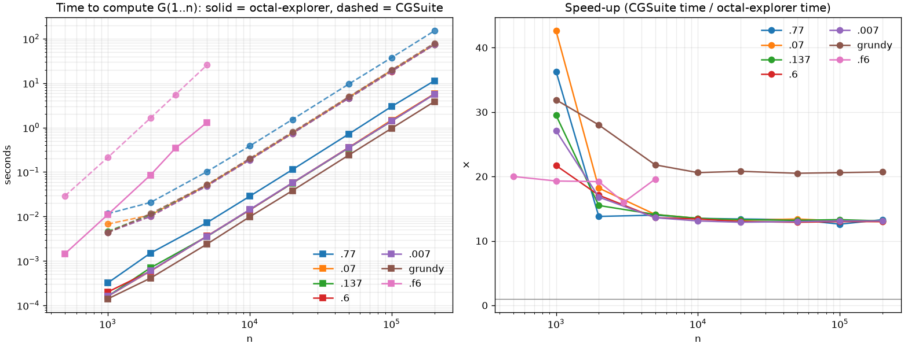

# Benchmark: octal-explorer vs CGSuite

Date: 2026-11-09.  Machine: AMD Ryzen 9 7900X 12-Core Processor (24 logical cores), Linux-7.0.0-43-generic-x86_64-with-glibc2.43.
CGSuite: CGSuite 2.1.1 / Java 17.0.6 / Linux 7.0.0-43-generic / Heap memory: 8192 MB / CanonicalShortGames recognized: 8; REPL startup 0.50 s (excluded).
octal-explorer: C library via Python 3.15.1, cc (Ubuntu 15.2.0-16ubuntu1) 15.2.0, -O3 -march=native.
Each point is the minimum of 3 run(s); CGSuite caches are cleared before every run.

## Correctness

| Game | Values compared | Identical | Period (ours) | Period (CGSuite) |
|---|---|---|---|---|
| `.77` | 1 … 3,000 | yes | period 12, preperiod 71 (proved) | Periodicity(Period => 12, Preperiod => 71, Saltus => 0) |
| `.07` | 1 … 3,000 | yes | period 34, preperiod 53 (proved) | Periodicity(Period => 34, Preperiod => 53, Saltus => 0) |
| `.137` | 1 … 3,000 | yes | period 34, preperiod 52 (proved) | Periodicity(Period => 34, Preperiod => 52, Saltus => 0) |
| `.6` | 1 … 3,000 | yes | — | — |
| `.007` | 1 … 3,000 | yes | — | — |
| `grundy` | 1 … 3,000 | yes | — | — |
| `.f6` | 1 … 3,000 | yes | — | — |

## Timings (seconds)

### `.77` — Kayles

| n | octal-explorer | CGSuite | speed-up | G(n) agrees |
|---|---|---|---|---|
| 1,000 | 0.0003 | 0.0116 | 36.3× | yes |
| 2,000 | 0.0015 | 0.0207 | 13.8× | yes |
| 5,000 | 0.0073 | 0.1021 | 14.0× | yes |
| 10,000 | 0.0285 | 0.3851 | 13.5× | yes |
| 20,000 | 0.1133 | 1.5244 | 13.4× | yes |
| 50,000 | 0.7195 | 9.5800 | 13.3× | yes |
| 100,000 | 2.9825 | 37.4983 | 12.6× | yes |
| 200,000 | 11.2879 | 150.0899 | 13.3× | yes |

### `.07` — Dawson's Kayles

| n | octal-explorer | CGSuite | speed-up | G(n) agrees |
|---|---|---|---|---|
| 1,000 | 0.0002 | 0.0068 | 42.6× | yes |
| 2,000 | 0.0006 | 0.0108 | 18.2× | yes |
| 5,000 | 0.0036 | 0.0509 | 14.1× | yes |
| 10,000 | 0.0141 | 0.1915 | 13.5× | yes |
| 20,000 | 0.0570 | 0.7530 | 13.2× | yes |
| 50,000 | 0.3587 | 4.8229 | 13.4× | yes |
| 100,000 | 1.4816 | 19.3533 | 13.1× | yes |
| 200,000 | 5.7204 | 74.4123 | 13.0× | yes |

### `.137` — Dawson's chess

| n | octal-explorer | CGSuite | speed-up | G(n) agrees |
|---|---|---|---|---|
| 1,000 | 0.0002 | 0.0046 | 29.5× | yes |
| 2,000 | 0.0007 | 0.0108 | 15.5× | yes |
| 5,000 | 0.0035 | 0.0499 | 14.1× | yes |
| 10,000 | 0.0140 | 0.1890 | 13.5× | yes |
| 20,000 | 0.0561 | 0.7445 | 13.3× | yes |
| 50,000 | 0.3497 | 4.6191 | 13.2× | yes |
| 100,000 | 1.3996 | 18.5484 | 13.3× | yes |
| 200,000 | 5.6425 | 73.9335 | 13.1× | yes |

### `.6` — Officers (open)

| n | octal-explorer | CGSuite | speed-up | G(n) agrees |
|---|---|---|---|---|
| 1,000 | 0.0002 | 0.0044 | 21.7× | yes |
| 2,000 | 0.0006 | 0.0101 | 17.1× | yes |
| 5,000 | 0.0036 | 0.0490 | 13.6× | yes |
| 10,000 | 0.0140 | 0.1882 | 13.4× | yes |
| 20,000 | 0.0568 | 0.7412 | 13.0× | yes |
| 50,000 | 0.3552 | 4.5940 | 12.9× | yes |
| 100,000 | 1.4115 | 18.3461 | 13.0× | yes |
| 200,000 | 5.6760 | 73.5066 | 13.0× | yes |

### `.007` — Treblecross (open)

| n | octal-explorer | CGSuite | speed-up | G(n) agrees |
|---|---|---|---|---|
| 1,000 | 0.0002 | 0.0044 | 27.1× | yes |
| 2,000 | 0.0006 | 0.0100 | 16.8× | yes |
| 5,000 | 0.0036 | 0.0485 | 13.6× | yes |
| 10,000 | 0.0143 | 0.1865 | 13.1× | yes |
| 20,000 | 0.0573 | 0.7397 | 12.9× | yes |
| 50,000 | 0.3541 | 4.5878 | 13.0× | yes |
| 100,000 | 1.4042 | 18.4037 | 13.1× | yes |
| 200,000 | 5.5933 | 73.4212 | 13.1× | yes |

### `grundy` — Grundy's game (open)

| n | octal-explorer | CGSuite | speed-up | G(n) agrees |
|---|---|---|---|---|
| 1,000 | 0.0001 | 0.0043 | 31.9× | yes |
| 2,000 | 0.0004 | 0.0116 | 28.0× | yes |
| 5,000 | 0.0024 | 0.0521 | 21.8× | yes |
| 10,000 | 0.0098 | 0.2020 | 20.6× | yes |
| 20,000 | 0.0381 | 0.7933 | 20.8× | yes |
| 50,000 | 0.2414 | 4.9486 | 20.5× | yes |
| 100,000 | 0.9626 | 19.7845 | 20.6× | yes |
| 200,000 | 3.8359 | 79.3289 | 20.7× | yes |

### `.f6` — hexadecimal .f6

| n | octal-explorer | CGSuite | speed-up | G(n) agrees |
|---|---|---|---|---|
| 500 | 0.0015 | 0.0291 | 20.0× | yes |
| 1,000 | 0.0110 | 0.2120 | 19.3× | yes |
| 2,000 | 0.0856 | 1.6412 | 19.2× | yes |
| 3,000 | 0.3450 | 5.5099 | 16.0× | yes |
| 5,000 | 1.3034 | 25.5475 | 19.6× | yes |

## Summary

For n ≥ 5,000 the speed-up ranges from 12.6× to 21.8× (median 13.3×).

## Method

- CGSuite: `TakeAndBreak(code).NimValueSequence(n)` in the headless REPL (`org.cgsuite.lang.Repl`), timed from sending the line to the next prompt, after `:clear`.
- octal-explorer: `octalgames.compute(code, n+1)`, i.e. `octal_extend` in C (brute-force mex).
- Both are single-threaded algorithms; the JVM may use extra threads for JIT and GC.
- Grundy's game is `4!.0` in CGSuite.  Couples-are-forever has no CGSuite code and is not included.
- Reproduce: `uv run python benchmarks/bench_cgsuite.py` (options: `--quick`, `--games`, `--sizes`).
