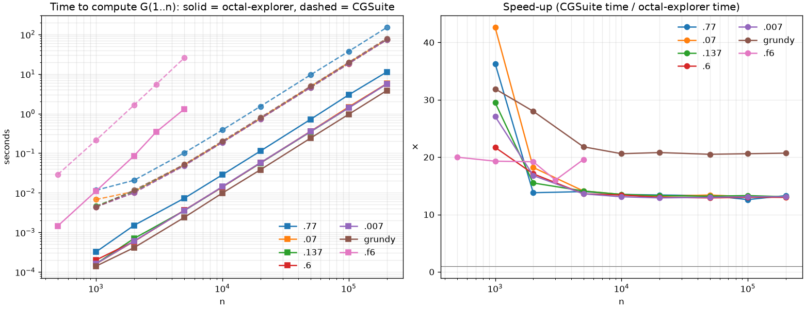

# Benchmark against CGSuite

**octal-explorer computes the same nim-sequences as CGSuite 2.1.1, about 13× faster on
octal games and about 20× faster on Grundy's game and the hexadecimal game.**  Both
grow as \(n^2\), so the gap is a constant factor and stays the same at large \(n\).  All
values and periods were identical.

Measured on 2026-11-09: AMD Ryzen 9 7900X (24 logical cores), Linux 7.0, CGSuite 2.1.1
on Java 17.0.6 with an 8 GB heap, gcc 15.2 with `-O3 -march=native`.



## Results

Seconds to compute G(1) … G(n); the minimum of 3 runs.

| Game | | n = 10,000 | n = 50,000 | n = 200,000 | speed-up at 200,000 |
|---|---|---|---|---|---|
| `.77` Kayles | ours / CGSuite | 0.029 / 0.385 | 0.72 / 9.58 | 11.3 / 150.1 | 13.3× |
| `.07` Dawson's Kayles | | 0.014 / 0.192 | 0.36 / 4.82 | 5.7 / 74.4 | 13.0× |
| `.137` Dawson's chess | | 0.014 / 0.189 | 0.35 / 4.62 | 5.6 / 73.9 | 13.1× |
| `.6` Officers | | 0.014 / 0.188 | 0.36 / 4.59 | 5.7 / 73.5 | 13.0× |
| `.007` Treblecross | | 0.014 / 0.187 | 0.35 / 4.59 | 5.6 / 73.4 | 13.1× |
| `grundy` (`4!.0`) | | 0.010 / 0.202 | 0.24 / 4.95 | 3.8 / 79.3 | 20.7× |

For the hexadecimal game `.f6`, where three-heap moves cost \(O(n^2)\) per heap size, the
largest size run was n = 5,000: 1.30 s against 25.5 s, a 19.6× speed-up.

Kayles takes twice as long as the other octal games in both tools.  It allows splitting
after removing one *or* two beans, so it has twice as many two-heap options.

## Correctness

For every game, CGSuite and octal-explorer gave identical values for n = 1 … 3,000, and
G(n) agreed at every benchmarked size.  For the three periodic games, CGSuite's
`CheckPeriodicity` matches the periods octal-explorer proves:

| Game | Period | Preperiod |
|---|---|---|
| `.77` Kayles | 12 | 71 |
| `.07` Dawson's Kayles | 34 | 53 |
| `.137` Dawson's chess | 34 | 52 |

## Method

- **CGSuite** is driven through its headless REPL (`org.cgsuite.lang.Repl` in
  `cgsuite-core.jar`) over a pipe.  `TakeAndBreak(code).NimValueSequence(n)` is timed from
  sending the line until the next prompt, so JVM startup (0.5 s) is excluded.  The REPL's
  caches are cleared with `:clear` before every run, and each game gets one untimed JIT
  warm-up.
- **octal-explorer** is timed on the C library call only, through
  `octalgames.compute(code, n + 1)`.
- Both algorithms are single-threaded.  The JVM may use extra threads for JIT compilation
  and garbage collection.
- If a CGSuite run takes more than 120 s, its remaining repeats are skipped.  This
  happened only for Kayles at n = 200,000, which is a single run.
- Couples-are-forever has no CGSuite code and is not included.

## Reproduce

```sh
make bench            # full run, about 30 minutes; writes benchmarks/results/
make bench-quick      # sizes up to 10,000 (hexadecimal up to 2,000), one run each: a minute or two
uv run python benchmarks/bench_cgsuite.py --games .007 .6 --sizes 1000 10000 100000
```

`CGSUITE=/path/to/CGSuite make bench` points to a different installation.  The raw
numbers are in `benchmarks/results/results.csv`, and the generated report is
`benchmarks/results/report.md`.
